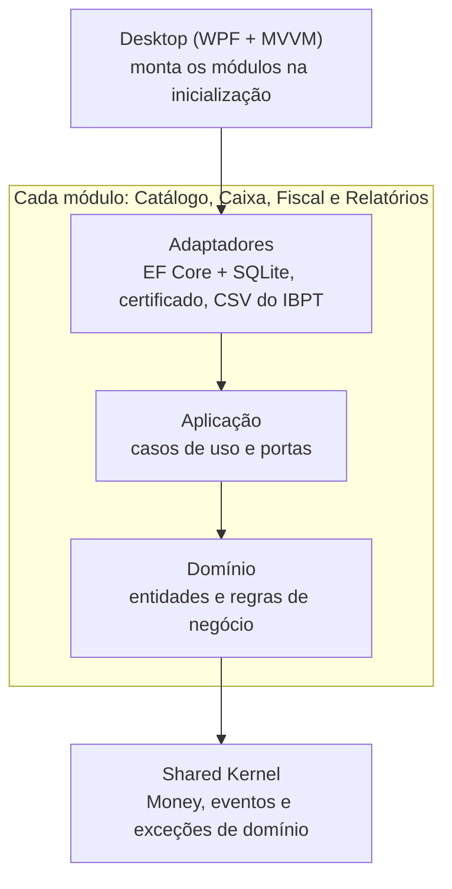

# pos-nfce

Frente de caixa (PDV) desktop para Windows com emissão de NFC-e, feita em .NET 10 e WPF.

> **Em desenvolvimento.** Cadastros, regras tributárias e o fluxo de venda já funcionam. A próxima etapa é gerar, assinar e transmitir a NFC-e para a SEFAZ.

## O que já funciona

- **Produtos:** cadastro com validação de GTIN, NCM e CEST, origem da mercadoria e ativação ou desativação de itens.
- **Regras tributárias:** CFOP, CSOSN, CST de PIS/COFINS e os códigos da reforma tributária (CST de IBS/CBS e cClassTrib).
- **Tabela IBPT:** importação do CSV para mostrar o valor aproximado dos tributos de cada item (Lei 12.741/2012).
- **Caixa:** venda por código de barras, desconto na venda, pagamento em dinheiro (com troco), cartão de crédito, débito ou Pix, cancelamento e fechamento.
- **Emitente:** CNPJ, endereço, regime tributário (Simples Nacional), certificado A1 e CSC. Os segredos são criptografados com o DPAPI do Windows antes de ir para o banco.

## Arquitetura

O projeto é um monólito modular. Cada módulo (Catálogo, Caixa, Fiscal e Relatórios) segue a arquitetura hexagonal, com domínio, aplicação e adaptadores em projetos separados.



- O domínio depende só do Shared Kernel.
- A aplicação depende do próprio domínio e, quando precisa, dos casos de uso de outros módulos. Nunca do domínio de outro módulo.
- Os módulos conversam por eventos: o Caixa publica `SaleCompleted` ao fechar uma venda, e o Fiscal vai tratar esse evento para emitir a nota.
- Essas regras são verificadas por testes de arquitetura (`tests/PosNfce.ArchitectureTests`), que leem os `.csproj` e falham se alguma referência proibida aparecer.

## Tecnologias

.NET 10, C#, WPF com CommunityToolkit.Mvvm, EF Core com SQLite e xUnit. O build trata avisos como erros e as versões de pacotes ficam centralizadas em `Directory.Packages.props`.

## Como rodar

Requisitos: Windows e o .NET SDK 10.0.402 (definido no `global.json`).

```powershell
dotnet tool restore
dotnet build
dotnet test
dotnet run --project src/PosNfce.Desktop
```

O banco fica em `%LOCALAPPDATA%\PosNfce\pos.db` e as migrações rodam na inicialização. Para usar outra pasta, defina a variável `POSNFCE_DATA_FOLDER`.

### Dados de desenvolvimento

```powershell
dotnet run tools/create-dev-certificate.cs   # certificado A1 fictício, só para desenvolvimento
dotnet run tools/seed-dev-data.cs            # emitente, regras, produtos e tabela IBPT de exemplo
```

Os dados são fictícios e os valores tributários estão marcados como "(TESTE)". As classificações reais vêm do contador.

### Teste de interface

`tools/ui-smoke-test.ps1` abre o app com o Windows UI Automation numa pasta de dados descartável, preenche as telas de regras tributárias, produtos, tabela IBPT e emitente e salva uma captura de cada etapa.
